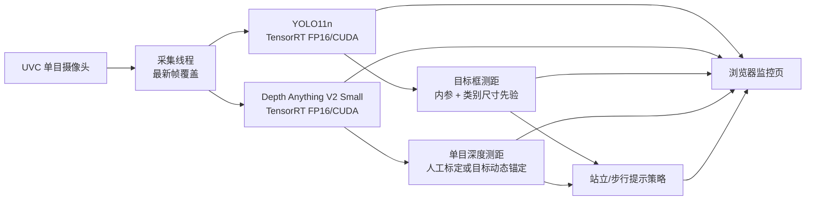

# LUMINA Guide Mono 应用场景开发报告

版本：0.2.0  
日期：2026-11-02  
设备：NVIDIA Jetson Orin Nano（4GB 级统一内存）  
仓库：<https://github.com/CH-LaTiao/lumina-guide-mono>

## 1. 报告范围

本报告说明单目摄像头原型从普通 UVC 摄像头获取画面，经过 CUDA/TensorRT
目标检测与单目深度估计，形成近似距离、方向提示和浏览器监控页面的完整流程。

本系统面向研究与工程验证，默认 `movement_allowed=false`。单目测距不是安全级
距离传感器，不能替代白手杖、导盲犬、陪同人员或交通判断。

## 2. 硬件环境

| 项目 | 当前环境 |
| :--- | :--- |
| 计算平台 | NVIDIA Jetson Orin Nano，aarch64，4GB 级统一内存 |
| 系统 | Ubuntu 22.04.5 LTS，L4T R36.4.3，Linux 5.15 |
| GPU | Orin，4 SM，Compute Capability 8.7 |
| CUDA | 12.6 |
| TensorRT | 10.3.0 |
| cuDNN | 9.3 |
| DeepStream | 7.1（已安装，当前版本不依赖） |
| 摄像头 | icSpring UVC，USB 2.0 连接，`/dev/video0` |
| 图像格式 | MJPG，1280×720，摄像头声明 30 FPS |
| 存储 | 116GB NVMe，运行空间约 91GB 可用 |
| 内存策略 | 约 3.6GB 物理内存，可配置大容量 Swap |
| 网络 | Jetson 与监控终端处于可互通的局域网，Web 端口 8766 |

摄像头 `/dev/video1` 是该设备暴露的元数据节点，不能作为独立视频流打开。系统默认
使用 `/dev/video0`，支持断线检测、重新打开和最新帧覆盖。

## 3. 系统功能

### 3.1 数据流



### 3.2 实时采集

- UVC MJPG 采集，默认 1280×720。
- 采集线程只保留最新帧，推理变慢时不会无限积压旧画面。
- 采集失败进入重连，网页同时显示摄像头状态与帧龄。
- 标注流、深度图和 JSON 状态分别提供。

### 3.3 目标检测

- 模型：YOLO11n，COCO 80 类。
- 引擎：TensorRT 10.3，FP16，CUDA 执行。
- 输入：`1×3×640×640`。
- 输出：`1×84×8400`。
- 后处理：置信度过滤、NMS、原图坐标还原。
- 框内显示类别、置信度、近似距离或“距离未知”。

### 3.4 单目测距

系统同时使用两级测距：

| 方法 | 适用对象 | 计算 | 误差说明 |
| :--- | :--- | :--- | :--- |
| 目标尺寸先验 | 人、车、椅子、桌子等有通用尺寸的 COCO 目标 | `Z ≈ 实际高度 × fx / 像素高度` | 目标姿态、遮挡和视场角会造成误差，一般标记 ±25%–55% |
| 稠密单目深度 | 墙面、桌椅边缘、未识别障碍等 | `Z ≈ scale / relative_disparity` | 必须有人工标定或检测目标动态锚点 |

深度比例有两种来源：

1. 用户在页面输入一个已知距离，系统保存中央区域的中位逆深度作为持久标定。
2. 未手工标定时，系统从当前帧中已有有效距离的检测目标提取锚点，为中左区域
   提供当帧近似距离。此类结果标记为 `auto_object_anchor_depth`，误差约 ±45%。

没有可靠比例时，页面只显示“较近／中等／较远”，不伪造米数。目标框接触画面边缘、
高度过小、类别没有可靠尺寸先验时，同样返回“距离未知”。

### 3.5 站立与步行提示

- 站立观察：可以描述前方或侧方目标，鼓励用户继续询问。
- 步行提示：使用一句短句，优先“停”或明确方向。
- 中央近物存在时，不把已经排除的中央区域重新作为“走中”方案。
- 摄像头断流、帧龄超过 1 秒或推理故障时，立即撤回旧方向。
- 所有结果保留 `movement_allowed=false`。

### 3.6 浏览器监控

`http://<JETSON_IP>:8766/` 提供：

- 带识别框和中文提示的实时画面；
- 单目深度热图；
- 左、中、右近似距离；
- 目标类别、置信度、近似米数和误差范围；
- 检测与深度耗时、摄像头 FPS、帧龄；
- GPU 利用率、GPU 温度、内存占用；
- 站立、步行、暂停控制和已知距离标定。

服务由 systemd 管理，异常退出后自动恢复，并设置开机启动。

## 4. 模型参数

| 模型 | 用途 | 参数量 | 输入 | 输出 | 部署 |
| :--- | :--- | ---: | :--- | :--- | :--- |
| YOLO11n | COCO 目标检测 | 约 2.59M | 1×3×640×640，RGB，FP32 输入 | 1×84×8400，FP32 输出 | TensorRT 10.3 FP16/CUDA |
| Depth Anything V2 Small | 单目相对逆深度 | 约 24.8M | 1×3×518×518，RGB，ImageNet 标准化 | 1×518×518 | TensorRT 10.3 FP16/CUDA |
| MiDaS Small v2.1 | 无 TensorRT 引擎时的深度回退 | 约 21M | 1×3×256×256 | 1×256×256 | OpenCV DNN/CPU |

目标检测引擎文件约 7.9MB，深度引擎约 55MB。模型和引擎不提交到 Git，因为二进制
文件受上游许可、平台版本和构建环境影响。

## 5. 当前运行效果

### 5.1 已验证环境

| 指标 | 结果 |
| :--- | :--- |
| 摄像头识别 | `icSpring WebCamera`，`/dev/video0` |
| 分辨率 | 1280×720 |
| 采集实测 | CPU 基线版本约 14.9–15.0 FPS |
| CPU 目标检测 | 约 217–232 ms/帧 |
| CPU MiDaS 深度 | 约 154–181 ms/帧 |
| TensorRT YOLO 同机记录 | 约 32.47 ms/帧，provider=`CUDA` |
| TensorRT 深度引擎 | 约 55MB，输入/输出结构已加载核验 |
| GPU | 4 SM，驱动正常，TensorRT 可识别 Compute Capability 8.7 |
| Web 页面 | 已能从局域网读取，画面流和深度图 HTTP 200 |
| 服务 | systemd 启停和开机自启已验证 |

CPU 检测和深度可以运行，但难以满足及时避障。接入 TensorRT/CUDA 后，目标检测延迟
约降至原来的七分之一；最终双引擎页面指标以部署后的实时状态页为准。

### 5.2 运行限制

- 单目没有真实视差，距离必须依赖目标尺寸先验或深度比例估计。
- 玻璃、镜面、白墙、重复纹理、细杆、悬空物和强逆光仍需专项测试。
- 目标框测距依赖实际视场角；报告默认值为 68°，应通过标定替换。
- 页面显示的 GPU 利用率与温度来自 `tegrastats`，用于监控，不用于性能验收。
- 当前“可走”意味着画面未发现高风险证据，不是安全通行许可。

## 6. 应用场景

| 场景 | 系统动作 | 典型输出 | 当前适用性 |
| :--- | :--- | :--- | :--- |
| 办公室/桌面调试 | 持续检测显示器、椅子、杯子和人，展示深度与距离 | “chair 约 2.8m”“前方未发现近物” | 已完成桌面联调 |
| 室内走廊 | 比较左、中、右深度，检测近处人物和障碍 | “右侧近物，向左”“停，前方近物” | 需真实走廊和佩戴验收 |
| 楼梯与台阶 | 识别近处结构变化，结合下部深度趋势提示 | “停，有落差”，等待用户确认 | 需专项训练和测试 |
| 地铁站与闸机 | 按需描述指示牌、闸机、柱子和人流 | “前方约 1.5m 有行人” | 可做观察辅助，导航协同仍在发展 |
| 电梯口 | 检测门、人物和近距离障碍 | “前方近物，停” | 需门体运动与反光专项验证 |
| 公共道路 | 检测车辆、行人、交通灯候选 | 只作辅助提示 | 不可用于独立过街决策 |
| 低照度室内 | 依赖检测与增强后的深度质量 | 状态明确显示质量和帧龄 | 需补充照明数据 |
| 产品演示与研发监控 | 单页显示画面、框、深度、距离、GPU 状态 | 全流程可视化 | 已具备 |

## 7. 验收建议

在进入真实佩戴前，至少完成：

1. 用卷尺或激光测距仪在 1、2、3、5 米位置测试已知尺寸目标，记录平均误差、P90
   误差和缺失率。
2. 对人物正视、侧身、蹲下和部分遮挡分别评估，避免把姿态变化误当作距离变化。
3. 在玻璃门、镜面、白墙、深色衣物、细杆和低照度环境测试检测与深度失效。
4. 标定真实镜头水平视场角和相机安装俯仰，替换默认参数。
5. 测量端到端时延：采帧到检测、采帧到深度、采帧到页面更新。
6. 长时间运行至少 2 小时，观察温度、内存、Swap、GPU 利用率和重连次数。
7. 在封闭场地做受控佩戴测试，由视障用户评价提示是否简短、方向是否可理解。

## 8. 部署与运行

目标目录：

```text
/home/ubuntu/lumina-guide-mono
```

启动：

```bash
sudo systemctl restart lumina-guide-mono.service
```

状态：

```bash
systemctl status lumina-guide-mono.service
curl http://127.0.0.1:8766/status
```

浏览器：

```text
http://10.3.58.16:8766/
```

## 9. 结论

单目版本已经形成“采集、检测、单目深度、近似测距、方向提示、浏览器监控、自动恢复”
的完整工程链路。CUDA/TensorRT 将视觉推理从 CPU 迁移到 Orin GPU，是部署的正式路径；
CPU 与 MiDaS 仅保留为故障回退。下一阶段的重点是实测双引擎延迟、标定真实镜头参数，
并针对视障用户验证提示方向和距离误差是否足够可靠。
